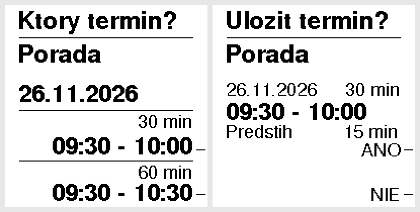
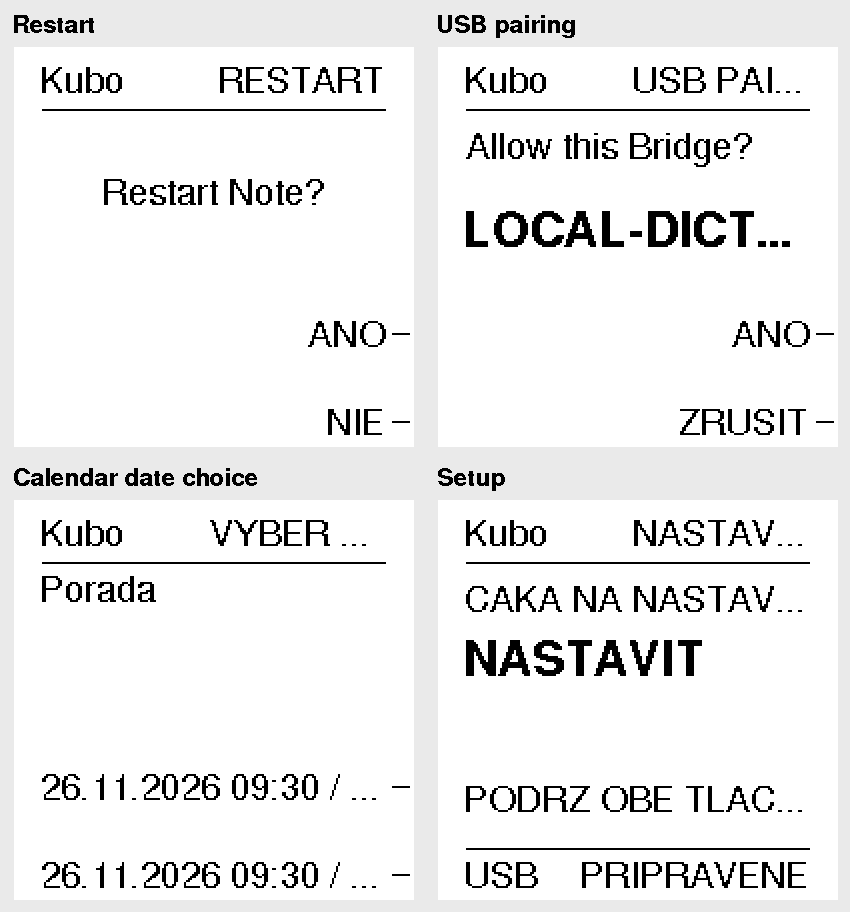

# Kubo Note screen and button review

26 November 2026. Reviewed the 200 × 200 device UI in the working tree based
on `4b64b23`, including the `2.0.0-recorder-test4-timing2` layout on the
development Note. The initial review covers the on-device screens and their input handlers.
The calendar change below was implemented after the review and verified on
the host. The development Note was running timing2 during the review.

## What works

On the restart, pairing and calendar prompts, the upper action occupies its
own row at the right edge (text starts at y=137). The lower action uses the
bottom right (y=181). The upper label sits level with the upper case button.
The lower button sits below the active panel, so the bottom corner is the
closest available position. The restart and pairing handlers agree with
these labels. Waiting for pairing offers just the lower Cancel action.
Calendar date selection maps the upper and lower buttons to the first and
second proposals respectively. The save prompt maps upper to Yes and lower
to No. A calendar timeout leaves the proposal pending.

The interaction and geometry are in the [display code](../../devices/kubo-note/pala_note/src/app/ui.cpp),
[button handlers](../../devices/kubo-note/pala_note/pala_note.ino),
[calendar input routine](../../devices/kubo-note/pala_note/src/app/calendar_button.h)
and [Waveshare enclosure drawing](https://docs.waveshare.com/ESP32-S3-ePaper-1.54#dimensions).

## Timing3 follow-up on the development Note

USB pairing now wraps the computer name and displays the last eight characters
of the Bridge ID. The restart screen shows the deadline. Once the screen is
drawn, one 30-second interval is available. An unanswered request shows an
expiry message on the Note. The settings protocol distinguishes expiry,
cancellation and confirmation by request ticket. The updated settings page
can report that outcome for a matching ticket.

Fatal SD startup errors now identify the card and instruct the operator to
check it and restart the Note. Microphone and memory faults have their own
messages. The separate low-space recording outcome described below remains
open. Eighteen host-rendered Slovak and English cases passed text-fit and
overlap checks, including two similarly named computers and a 32-letter wide
name. On the development Note the paired USB client observed a real request
change from pending to expired with the same ticket.

## Findings in the initial review

### 1. USB pairing can hide which computer the user approves

The large Bridge name has 172 pixels. Two valid examples,
`LOCAL-DICTATION-A` and `LOCAL-DICTATION-B`, each need 248 pixels and both
appear as `LOCAL-DICT...`. The upper button approves the displayed request.
Use the spare space above the buttons to wrap the name and retain a
distinguishing suffix or short identifier. On the Bluetooth variant, the
six-digit code fits, but `Compare code on PC` becomes `Compare code o...`.
Ask directly whether the codes match, in the selected language.

### 2. Calendar choices hid their differences (corrected in source)

Both `26.11.2026 09:30 / 30 min` and `26.11.2026 09:30 / 60 min` require
209 pixels. Both rows originally rendered as `26.11.2026 09:30 / ...`. The same formatting
hid the duration on the final save screen. These were synthetic inputs to
the shared calendar UI. The fixed picker gives the question a full-width
heading, wraps the event title and groups a common date above the options.
Each same-day option shows the duration and a bold start–end time. When
the start dates differ, the date accompanies its own option. An overnight
or multi-day option has separate start and end lines with full dates.
The save screen repeats the selected interval and reminder setting.

### 3. Recording and startup errors give the wrong recovery cue

The prominent Slovak message is `SKUS ZNOVA`. A failed recording returns to
Home after a short delay. A startup SD or microphone fault stays on the
screen and does not process a retry button. Also, a recording stopped early
by the low-space check can reach the normal Saved screen if finalization
succeeds. An overflow, by contrast, can retain a recoverable WAV prefix and
show Record Again.

Show the reason and available next action first. For recording outcomes,
distinguish a complete recording, a verified saved portion and an unverified
write. For a boot SD error, identify the card and the need to restart after
checking it. See [record finalization](../../devices/kubo-note/pala_note/src/app/record.cpp)
and [recording and boot handlers](../../devices/kubo-note/pala_note/pala_note.ino).

### 4. The restart deadline is invisible

The confirmation expires 30 seconds after the request arrives. Panel refresh
and the wait for released buttons use part of that window. Expiry silently
restores the previous Home or Companion screen. This was also observed as a
missed prompt during the bench session. The Slovak screen combines
`Restart Note?` with `ANO` and `NIE`. Localize the question, make the time
limit visible without frequent panel refreshes and report expiry at the
requesting computer. See the [restart deadline](../../devices/kubo-note/pala_note/src/app/storage_audit_policy.h).

### 5. Setup truncates the gesture the user needs

`PODRZ OBE TLACIDLA` requires 196 pixels and appears as `PODRZ OBE TLAC...`.
The handler requires a three-second hold. Use the spare vertical space for
one instruction on two lines, for example `Podrz obe tlacidla` / `na 3 sekundy`.
Keep the USB readiness message together so its meaning is distinct from the
device waiting for setup. This shared setup state is bypassed by the runtime
Bridge configuration used in the test.

### 6. Navigation labels can describe the wrong button or action

In the shared firmware, ordinary agenda and month pages use upper to advance
and lower for Home. Recorder-first currently disables this page cycle.
The legacy Events shortcut instead advances with lower and exits with upper.
Both present horizontal navigation. In Ask Kubo, upper exits and lower
advances. On the final answer page, the footer says End / Back while lower
wraps to the first page. Use explicit mappings per entry path. If a dense
calendar or answer leaves no room for stacked actions, label the buttons in
a reserved footer. On the final page, label the actual wrap or change the action.

## Other screens reviewed

| Screen family | Result |
| --- | --- |
| Home, recording, recording marker, saved | Home and active recording need no approval. A saved status is suitable after a complete capture. Early-stop feedback is covered above. |
| Processing, synchronization, audit progress | Status or progress only. Separate from the explicit restart-and-check question. The recorder target accepts ordinary restart, while the audit option belongs to the shared firmware. |
| Companion connecting, offline, Wi-Fi and hotspot | The shared two-button exit instruction describes one gesture. The Slovak footer fits at 162 pixels. The volume overlay labels upper + and lower − correctly. Their horizontal layout is a lower-priority improvement. |
| Ask listening, processing, speech and answer | Listening and processing are status screens. The answer is navigable. The recorder target currently disables the Home shortcut to Ask. |
| Sleep and aquarium | Normal sleep preserves Home with a lock and wakes on the lower button. The alternate dedicated sleep screen has no current caller. The aquarium uses animation frames and gestures. Neither flow presents a binary question. |

## Verification

Compared display code against its handlers and measured strings using the
shipped GFX glyphs and the firmware's width and ellipsis rules. The normal
body column is 172 pixels, and the right header slot is 88 pixels. Checks
focused on Slovak and English. The four panels below reconstruct the original
review build, including the calendar issue, at 2× size.

For the revised calendar, a native host harness ran the working-tree picker and
save routines using sample inputs and the shipped font metrics. All 28 screens
stayed within the panel. The program checked each text and rule for overlap,
verified that the input dates and times were visible, and checked the two edge
cues. Cases included identical starts with different ends, different days and
years, overnight and multi-day events, a 250-character title, missing end times
and the largest supported reminder. Physical contrast, ghosting and legibility
of every state still need a hands-on pass.

